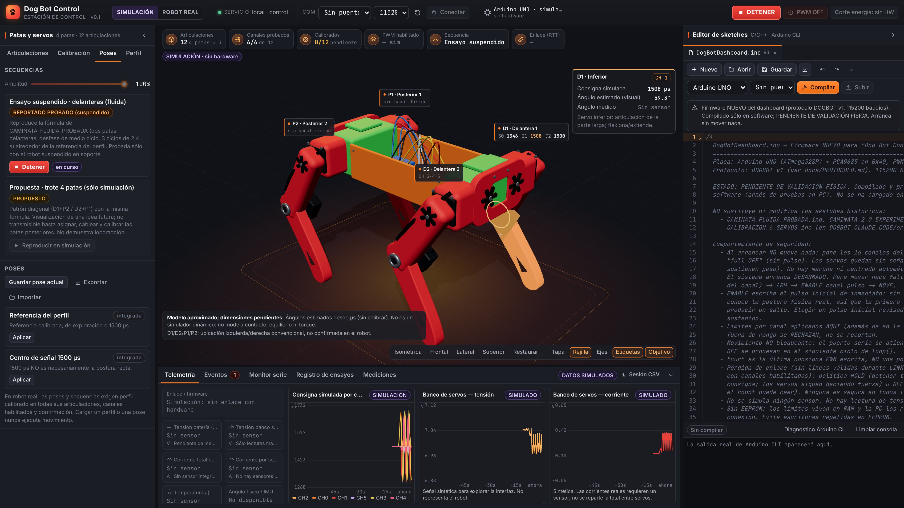
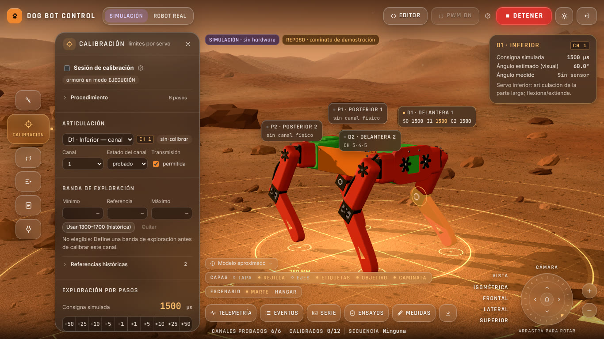
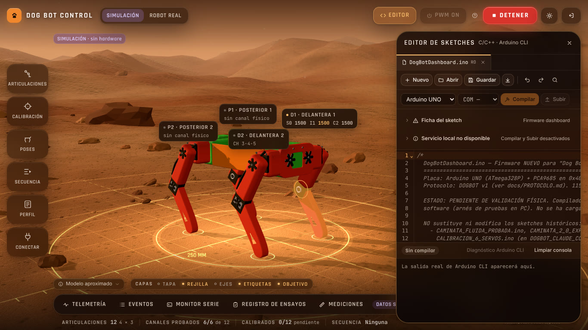
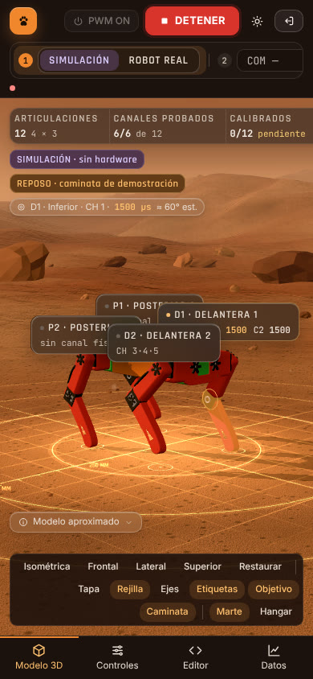

# Dog Bot Control

Estación de control local para Windows del robot cuadrúpedo **Dog Bot**: modelo 3D
articulado, controles de servos, calibración, editor de sketches con compilación y
carga reales mediante Arduino CLI, telemetría honesta y registro de ensayos.

> **Estado del robot (dossier, 3‑nov‑2026):** dos patas delanteras con seis servos
> (canales 0–5) movidas en secuencias coordinadas **con el cuerpo suspendido en un
> soporte**. No está demostrado que se sostenga ni camine sin apoyo.
>
> **Estado de esta aplicación (v0.1.0):** funciona en **modo simulación**. El servicio
> local, el firmware nuevo y el modo ROBOT REAL están implementados y probados **solo en
> software**. Faltan las pruebas físicas: USB/COM en Windows, carga en la placa y movimiento
> real. Ver [docs/PRUEBAS.md](docs/PRUEBAS.md).
>
> **Placas (firmware 0.2.0):** el robot se puede controlar con un **Arduino UNO** o con un
> **ESP32** (DevKit, WROOM-32), con el mismo firmware y el mismo protocolo. La variante ESP32
> está probada solo en software y **aún no se ha compilado con el core real de Espressif**.
> Ver [docs/ESP32.md](docs/ESP32.md).



| Portátil 1366×768 | Editor de sketches | Celular |
|---|---|---|
|  |  |  |

**Interfaz.** El visor 3D ocupa toda la ventana, sobre un terreno marciano procedural (escenario
visual: no simula contacto ni dinámica; los anillos y la regla del suelo sí están a escala del
modelo). Encima flotan paneles de cristal:

- **Riel izquierdo**: Articulaciones, Calibración, Poses, Secuencia, Perfil y Conectar. Cada botón
  abre su panel al lado; otro clic lo cierra.
- **Arriba a la derecha**: Editor, PWM ON/OFF, DETENER, modo claro/oscuro y Salir.
- **Base**: pestañas de datos (Telemetría, Eventos, Monitor serie, Registro de ensayos y
  Mediciones) que se despliegan al pulsarlas, la franja de indicadores y, en la esquina, las
  vistas de cámara con el dial de órbita y el zoom.

> `docs/capturas/robot-real-puerto-virtual-1366.jpg` muestra el modo ROBOT REAL con un **puerto
> serie virtual** conectado al firmware ejecutado en la PC (`firmware/pruebas_host`), sin hardware
> real. Es de la interfaz anterior al HUD: no se ha vuelto a tomar.

## Uso rápido en Windows

1. Instala **Node.js 22 LTS o 24 LTS** desde <https://nodejs.org>.
2. Para compilar y subir sketches, instala **Arduino IDE 2**, que ya incluye `arduino-cli`.
   También sirve `arduino-cli` por separado. Si usas un ESP32, hace falta además su core
   (`esp32:esp32`), que se instala desde el propio dashboard.
3. Descarga este repositorio (rama `ccr-c852bcef-htj9dj`) en una carpeta. La ruta puede
   tener espacios.
4. Doble clic en **`INSTALAR_DOGBOT.bat`**. Solo hace falta la primera vez y después de cada
   actualización.
5. Doble clic en **`INICIAR_DOGBOT.bat`**. Se abre `http://127.0.0.1:5178` en el navegador.

La aplicación arranca en **SIMULACIÓN**. Abrirla no mueve el robot ni carga firmware.
La guía detallada, con la primera conexión al robot, está en
[docs/INSTALACION_WINDOWS.md](docs/INSTALACION_WINDOWS.md).

## Qué incluye

| Parte | Ubicación | Estado |
|---|---|---|
| Interfaz (React + TypeScript + Three.js + CodeMirror) | `src/` | Funcional en simulación; revisada a 1366×768, 1920×1080 y 390×844 |
| Núcleo compartido: articulaciones, perfiles, protocolo, cliente, secuencias, telemetría | `shared/` | Con pruebas automáticas |
| Servicio local Node.js: COM, Arduino CLI, sketches | `service/` | Probado con puerto virtual y Arduino CLI simulado; **pendiente en Windows** |
| Firmware nuevo `DogBotDashboard.ino` (protocolo DOGBOT v1) para **UNO y ESP32** | `firmware/DogBotDashboard/` | Compila para UNO con avr‑gcc (43 % flash, 41 % RAM estática). Variante ESP32 sin compilar con su core real. **Pendiente de validación física** |
| Catálogo de placas (UNO, ESP32) | `shared/boards.ts` | Lista blanca de placas, core y tipo de binario de cada una |
| Arnés para ejecutar el firmware en la PC | `firmware/pruebas_host/` | Pruebas de software del firmware real, en sus variantes UNO y ESP32 |
| Perfil inicial de calibración | `perfiles/perfil_inicial_v1.json` | 6 canales probados, **sin calibrar**; posteriores sin canal |
| Documentación de entrega original (sin cambios) | `DOGBOT_CLAUDE_CODE/` | Contexto, prompt, 3 sketches históricos y fotos |
| Mis sketches (editor) | `sketches/` | Copias y sketches nuevos |

## Documentación

- [Instalación y arranque en Windows](docs/INSTALACION_WINDOWS.md)
- [Protocolo serie DOGBOT v1](docs/PROTOCOLO.md)
- [Calibración paso a paso](docs/CALIBRACION.md)
- [Estados, modos y acciones de parada](docs/ESTADOS_Y_SEGURIDAD.md)
- [Telemetría y registros](docs/TELEMETRIA.md)
- [Compilación y carga de firmware](docs/CARGA_FIRMWARE.md)
- [**Dog Bot con ESP32**: cableado, core, carga y diferencias con el UNO](docs/ESP32.md)
- [Pruebas hechas y pruebas físicas pendientes](docs/PRUEBAS.md)
- [Decisiones, estado y próximos pasos (4 patas, Raspberry Pi 4)](docs/DECISIONES_Y_ESTADO.md)
- [**Plan de trabajo · Fase 1: pararse y caminar con Arduino**](docs/PLAN_FASE1.md) · [Plantilla de medidas del robot](docs/MEDICIONES_ROBOT.md)

## Arquitectura (resumen)

```text
Navegador (127.0.0.1:5178) ── HTTP + WebSocket con token ──> Servicio local Node.js
  React · Three.js · CodeMirror                              ├─ serialport (único dueño del COM)
  estado (zustand) · cliente de protocolo                     ├─ arduino-cli (argumentos estructurados, sin shell)
                                                              └─ sketches/ (rutas validadas)
Servicio ── USB/COM 115200 ──> Arduino UNO o ESP32 (DogBotDashboard.ino) ── I²C ──> PCA9685 0x40 ── PWM 50 Hz ──> servos
```

Una sola solución: interfaz web local servida por un servicio Node.js en Windows. La
interfaz también funciona sin el servicio, en simulación: se puede explorar el modelo, los
controles, el editor y las gráficas sintéticas rotuladas. Ver
[DECISIONES_Y_ESTADO.md](docs/DECISIONES_Y_ESTADO.md).

## Desarrollo

```bash
npm ci            # dependencias exactas (package-lock.json)
npm run dev       # servicio (5178) + Vite con recarga (5173)
npm test          # 93 pruebas (vitest)
npm run typecheck
npm run build     # dist/web + dist/service
npm start         # sirve la app compilada en http://127.0.0.1:5178
```

Versiones fijadas: Node ≥ 22.12, React 19.2.9, Three.js 0.186.1, Vite 7.3.6,
CodeMirror 6 (view 6.43.14, language 6.12.4), zustand 5.0.15, serialport 13.0.0,
ws 8.22.0, esbuild 0.27.2, TypeScript 6.0.3, Vitest 4.1.11. Las fuentes (Inter,
JetBrains Mono) se incluyen localmente. La aplicación no usa servicios en la nube.
